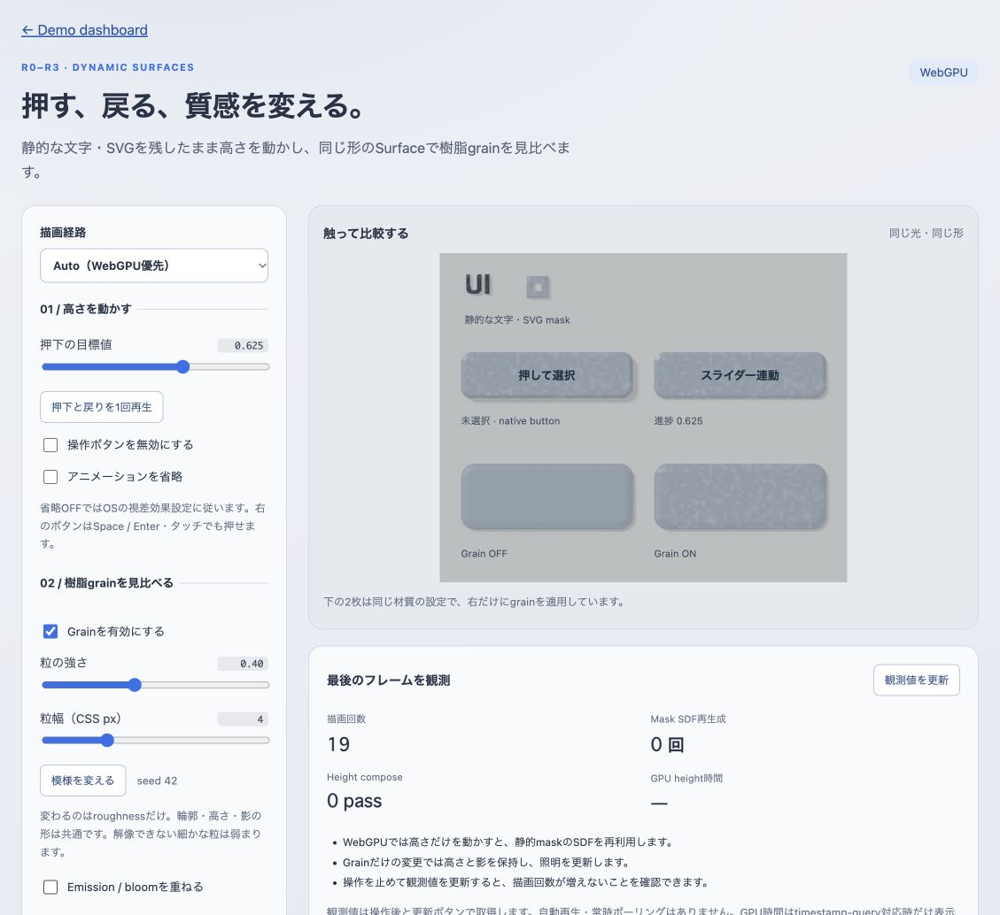

# R0〜R3の実装と検証

静的な文字・SVG maskと、連続的に高さが変わるbuttonを同一sceneに置き、更新時のSDF再計算を減らした。操作例と、roughnessだけに作用する樹脂の微細材質も追加した。

対象は[#79](https://github.com/MasafumiYamaguchi/Ukibori/issues/79)〜[#82](https://github.com/MasafumiYamaguchi/Ukibori/issues/82)。基準はmaster `16b8aa104b7f75ad502589539bdb9ee2353a52ff`。元の作業ツリーにあったデモ変更は含めず、最新masterから分けて実装した。

## 高さ処理は短縮したが、フレーム待ち時間の改善は確認できない

通常照明・発光ありを別々に、各60フレーム測定した。表の値は中央値 / p95、単位ms。GPU時間は`timestamp-query`、host時間は`performance.now()`による。GPU各passの全結果と個別sampleは[before.json](before.json)、[after-r1.json](after-r1.json)、[after-r3.json](after-r3.json)に保存した。

| 条件・指標 | R0（変更前） | R1（SDF保持） | R3（grain有効） |
| --- | --- | --- | --- |
| 通常 / GPU height | 2.699 / 2.716 | 0.129 / 0.130 | 0.130 / 0.132 |
| 通常 / GPU lighting | 0.037 / 0.042 | 0.037 / 0.037 | 0.040 / 0.041 |
| 通常 / DOM render host | 0.700 / 1.600 | 0.400 / 0.500 | 1.400 / 1.900 |
| 通常 / DOM計測 host | 0.000 / 0.100 | 0.000 / 0.100 | 0.000 / 0.100 |
| 通常 / scene構築 host | 0.100 / 0.100 | 0.000 / 0.100 | 0.100 / 0.200 |
| 通常 / scene upload host | 0.000 / 0.100 | 0.000 / 0.100 | 0.000 / 0.100 |
| 通常 / 更新〜GPU計測readback完了 | 16.700 / 18.100 | 17.900 / 18.900 | 16.700 / 17.500 |
| 発光・bloom / GPU height | 2.695 / 2.725 | 0.129 / 0.133 | 0.131 / 0.133 |
| 発光・bloom / GPU lighting | 0.037 / 0.040 | 0.037 / 0.043 | 0.040 / 0.041 |
| 発光・bloom / DOM render host | 1.600 / 1.900 | 0.500 / 1.600 | 1.500 / 1.900 |
| 発光・bloom / DOM計測 host | 0.100 / 0.200 | 0.000 / 0.100 | 0.100 / 0.100 |
| 発光・bloom / scene構築 host | 0.100 / 0.200 | 0.000 / 0.200 | 0.100 / 0.100 |
| 発光・bloom / scene upload host | 0.000 / 0.100 | 0.000 / 0.000 | 0.000 / 0.100 |
| 発光・bloom / 更新〜GPU計測readback完了 | 16.400 / 18.100 | 16.400 / 18.800 | 16.700 / 18.100 |

R1では高さ更新ごとの`maskSdfPasses`が1から0になった。通常照明のcompute dispatchは10→9、effects有効時は13→12で、composeの5 passは維持する。SDF以外の再設計は行っていない。

読み戻しを含む待ち時間にはschedulerの待機とGPU profilingのreadbackが含まれる。表示完了までのlatencyは未測定であり、60 FPSの保証には使わない。host計測は約0.1ms刻みなので、表の0は処理時間ゼロを意味しない。GPU presentationの計測値にも実行間の差があるため、全体の変化をSDF保持だけの効果とはしない。

R3は照明更新時に3 Surface分の240 byteを追加uploadする。通常照明は6400→6640 byte、effectsありは6560→6800 byteになった。lightingの中央値は約0.037→0.040msだが、DOM render hostは約0.4→1.4msへ増えた。R3ではhost処理時間とupload量が増えた。GPU allocationの追加は240 byteで、画像textureや常時readbackは導入していない。

## 入力と描画を分けて検証した

- R0: 固定fixtureの0 / 0.125 / 0.375 / 0.625 / 0.875 / 1と戻りを描画し、通常照明と発光・bloomを分けて保存。静止後のGPU serial不変も確認した。
- R1: 連続高さ変更でSDFが0回となること、mask追加・削除・順序・寸法・alpha・形式の変更、metadata/workspaceの再作成、失敗後のretry、dispose、device lossから新deviceでの復帰を検証した。強制フル再計算ではSDFも強制し、保持出力との完全一致を要求する。
- R2: Radixのprops/ref/event合成、Space / Enter、タッチ、pointercancel / capture喪失、blur、disabled、focus-visible、SSR/hydration、reduced-motionとunmountを確認した。WebGPU / CPU / CSSのnative操作結果を[press-browser.json](press-browser.json)へ保存する。
- R3: DPR 0.75 / 1 / 1.5 / 2、seed/scale変更、縮小、共有materialのSurface原点、平行移動・resize、材質だけの変更とidleを検証した。CPU/GPUの新規grain比較はRGBA8各channelで1 byte以内。既存goldenの誤差条件は変えない。

最終チェックは`npm test`（dev-loop 12件、renderer 1124件、DOM 218件、React 236件）、`npm run typecheck`、`npm run build`。実GPUのgolden gate結果は[webgpu-parity.json](webgpu-parity.json)に保存する。テストに使うreadbackは検証専用で、通常の描画へ追加しない。

操作中に観測したrender host時間は次のとおり。180×100の別sceneで、GPU profilingを有効にした操作テストから取得した。固定benchmarkの20 warmup/60 sampleとは異なり、入力・戻り・選択・unmount直前のフレームを含む。CPUはTypeScript参照描画のため、この条件でもGPUよりhost負荷が大きい。CSS経路は物理rendererを実行せず、GPU時間は未測定。

| 経路 | 観測フレーム数 | render host ms（中央値 / p95） |
| --- | --- | --- |
| webgpu | 36 | 1.400 / 2.700 |
| cpu | 26 | 13.300 / 16.500 |

unmount直前の進捗は0.768で、遷移の途中だった。unmount前後のGPU render serialはともに11で、後続のdispatchはなかった。

## 再現条件

| 項目 | 固定値 |
| --- | --- |
| 端末 | MacBook Pro / Apple M4 Pro / 24GB |
| OS | macOS 26.6.2（25G83） |
| browser / adapter | Headless Chrome 156 / Apple Metal 3（software adapterではない） |
| viewport / effective DPR | 800×600 / 1 |
| stage | 320×180 CSS px、margin 8 |
| scene | 3 Surface: Arial bold 16pxの「UI」、16×16 SVG evenodd mask、112×48 button |
| geometry | buttonのelevation `8−6p`、thickness `3−2p`、bevel幅4 |
| shadow | 8 samples、angularRadius 0.12、maxDistance 48、reconstruction radius 2 |
| warmup / sample | 各条件20更新 / 60更新 |
| grain | scale 3、strength 0.6、seed 42（R3の追加比較のみ） |

benchmarkは`packages/ukibori/test-browser/dynamic-surfaces.tsx`、runnerは`test-dynamic-surfaces.mjs`。通常の計測は`npm run test:dynamic:webgpu -w ukibori`、grain比較は`DYNAMIC_GRAIN=1`を付ける。`DYNAMIC_RESULT_PATH`を指定するとmarker付きの全結果を保存できる。R1の変更前を再測定するときは基準コミットへ同じfixture/runnerだけを適用する。

操作テストは`npm run test:press:browser -w ukibori`、renderer全体の実GPU比較は`npm run test:webgpu -w ukibori-renderer`。操作テストはCDPでfocus/visibilityを固定し、headlessのbackground throttlingを無効にする。操作テストのstageは180×100、buttonは100×40、DPR 1であり、上表の固定benchmarkとは別の場面である。

通常のブラウザで確認するには`npm run dev`からトップナビのInteraction & grain（`/#interaction`）、または`/interaction.html`を開く。buttonの押下・戻り・選択、無効ボタン、backend切替、emission/bloom、grainを確認できる。使い方は[操作ガイド](interaction.md)、座標とbuffer契約は[材質ガイド](material.md)を参照する。

レビュー後の再検証では、CPUのidle判定にscene構築回数を使い、WebGPUとCPUの遷移途中でunmountした。両経路で後続描画が増えないことを確認した。結果は[press-review-browser.json](press-review-browser.json)に保存した。

WASM選択の契約テストは実演算とparity比較を維持し、計測時間だけを固定した。速度の利点がある場合・ない場合の両方で、force指定が後続autoの再プローブを省略しないことを確認する。実機の速度はこのunit testの合否条件に含めない。
